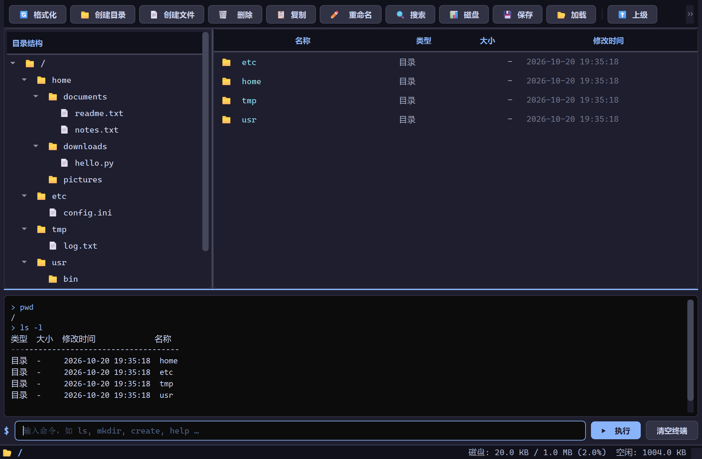
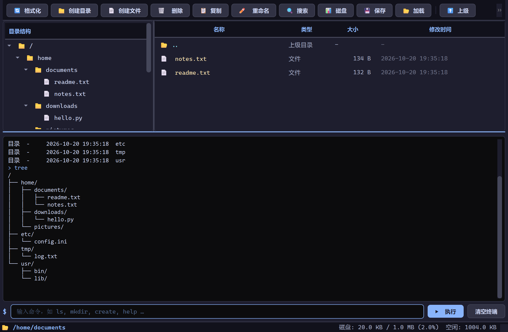

# 🗂️ FAT-like File System Simulator

在 1 MB 虚拟磁盘上从零实现的类 FAT 文件系统 —— 超级块、FAT 表、位图、多级目录、跨块读写与映像持久化，配套 PyQt6 图形界面与终端双端外壳。不依赖任何操作系统文件系统 API，所有数据都落在自己维护的 `bytearray` 与单个 `.img` 映像里。

<div align="center">


</div>

> 💡 **定位**：这是操作系统课程设计级的文件系统模拟器，用于演示「文件系统如何把字节变成文件」。它不挂载真实块设备、不进入内核态，也没有并发与权限模型 —— 边界见文末「已知边界」。

## ✨ 功能范围

| 模块 | 能力 |
| :--- | :--- |
| 🗄️ 磁盘管理 | 超级块（魔数 `FSYS` + 布局参数）、FAT 表、位图三重元数据；`format` 重建、`df` 用量统计 |
| 📁 目录服务 | 多级目录、绝对 / 相对路径解析、`.` `..` 语义；单块 6 条满后自动续链扩容 |
| 📄 文件操作 | 创建、删除、打开、关闭；跨块连续读写、按 offset 定点覆写、部分读取 |
| 🔗 空间分配 | 显式链接（FAT 链）为主、位图为辅的双重记录；删除时整条链一次性回收 |
| 🔍 检索导航 | `find` 名称子串搜索、`tree` 树形展示、`cp` 复制、`mv` 移动与重命名 |
| 💾 持久化 | 1 MB 映像原子落盘（临时文件 → `.bak` 备份 → 替换），加载时校验大小完整性 |
| 🖥️ 双端交互 | PyQt6 图形界面（目录树 + 文件表格 + 内嵌终端）与 22 条命令的 CLI，共享同一套核心引擎 |

## 📸 界面预览

图形界面把「结构」和「命令行」放在同一屏：左侧目录树、右侧文件明细、下方可直接敲命令的终端，改动会双向刷新。



树形结构、跨目录导航与终端输出实时联动，路径与磁盘占用常驻状态栏：



## 🏗️ 架构与磁盘布局

四层职责清晰，界面层不碰任何块操作，命令层只做参数解析与错误翻译。

| 文件 | 行数 | 职责 |
| :--- | ---: | :--- |
| `fs_core.py` | 769 | 核心引擎，零第三方依赖。块读写、FAT 链、目录项、路径解析、映像存取 |
| `fs_commands.py` | 298 | 22 条命令的解析与执行，异常统一翻译成中文提示 |
| `fs_gui.py` | 1026 | PyQt6 主窗口、深色主题、右键菜单、语法高亮终端 |
| `main.py` | 89 | 入口，`--cli` 切换终端模式 |
| `generate_docx.py` | 511 | 离线工具，用 python-docx 生成七章设计方案文档 |
| `verify.py` | 131 | 端到端验证脚本，24 项断言覆盖核心行为 |

磁盘布局固定为 1024 个 1 KB 块：

```text
块 0          超级块      魔数 / 总块数 / 块大小 / FAT 与数据区起始位置 / 空闲块数
块 1 – 4      FAT 表      1024 项 × 4 字节，FAT_FREE=-2，FAT_EOF=-1
块 5          根目录      目录项数组，每块 6 条
块 6 – 1023   数据区      1018 个块，文件与子目录的内容都落在这里
```

目录项定长 **153 字节**：`128 名称 + 1 属性 + 4 首块 + 4 大小 + 8 创建时间 + 8 修改时间`。用 `struct` 打包，文件名走 UTF-8，因此支持中文名（最多约 42 个汉字）。

## 🚀 快速开始

```bash
pip install -r requirements.txt

python main.py          # 图形界面
python main.py --cli    # 终端模式
```

首次启动找不到 `filesystem.img` 时会自动格式化，并预置一套演示目录（`/home/documents`、`/etc`、`/usr/bin` 等）。退出终端模式时自动保存映像。

打包成单文件可执行程序：

```bash
pyinstaller FAT_FileSystem_Simulator.spec
```

## ⌨️ 命令一览

| 分类 | 命令 |
| :--- | :--- |
| 目录 | `pwd` `ls [-l]` `cd <path>` `mkdir <name>` `rmdir <name>` `tree` |
| 文件 | `create <name> [size]` `delete <name>` `open <name>` `close <name>` `write <name> <text>` `read <name> [off] [n]` `stat <name>` |
| 移动 | `cp <src> <dst>` `mv <src> <dst>` `find <pattern>` |
| 系统 | `df` `format` `save [file]` `load [file]` `help` `clear` |

`find` 按名称**子串**匹配（不解析通配符），`ls -l` 的列宽按中英文显示宽度计算，保证终端里对齐。

## 🧪 验证

仓库自带端到端脚本，覆盖格式化、多级目录、目录自动扩容、跨块读写、定点覆写、中文长文件名、复制移动、子串搜索、删除回收、非空目录拒删、映像往返与错误处理：

```bash
python verify.py
```

```text
=== 结果: 24 通过 / 0 失败 ===
```

界面截图同样由真实运行的进程抓取，不是示意图。

## 📌 已知边界

- **无并发控制**：单线程设计，多进程同时写同一映像会互相覆盖。
- **无权限模型**：没有属主、权限位、ACL，任何进程都能读写任何文件。
- **无链接与挂载**：不支持硬链接、软链接、分区或挂载点。
- **元数据冗余**：FAT 与位图同时记录块分配状态，是为了演示两种分配方法，代价是存在不同步的理论风险。
- **目录项非对齐**：153 字节不是 2 的幂，每块浪费 106 字节（约 10%），换来的是长文件名能力。
- **映像不是裸盘**：`.img` = 1 MB 存储区 + 4 KB FAT + 1 KB 位图 + 路径头，比裸盘多 5124 字节。
